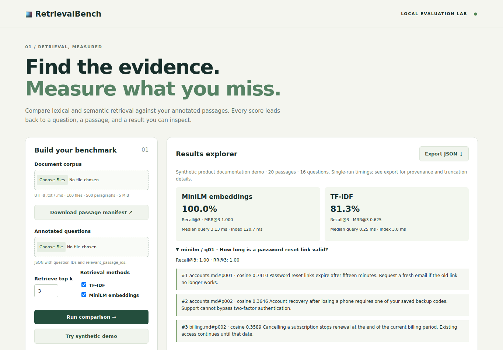

# RetrievalBench

**Evidence before answers.** A local retrieval evaluation workbench for developers deciding whether semantic search helps their small document corpus. Import text/Markdown, annotate relevant paragraphs, compare TF-IDF with pretrained MiniLM, inspect misses, and export reproducible JSON evidence. It evaluates retrieval, not generated-answer correctness.

## Run locally

Python 3.11 or 3.12, CPU, no paid services. Tested with Python 3.12 on Linux.

```sh
python -m venv .venv
source .venv/bin/activate  # Windows: .venv\Scripts\activate
python -m pip install -r requirements-lock.txt
python -m pip install -e . --no-deps
retrievalbench download
retrievalbench serve
```

Open http://127.0.0.1:8766 and click **Try synthetic demo**. The pinned public model downloads once (~90 MB). TF-IDF runs without it; uncheck MiniLM for a download-free demo. Set `RETRIEVALBENCH_OFFLINE=1` after caching to forbid model downloads. Model-load failure is explicit, never silently replaced with TF-IDF. The Flask development server is loopback-only; this is not a public hosting configuration.

## Bring your own data

1. Supply flat UTF-8 `.txt`/`.md` files with unique plain filenames. Blank lines separate passages; Markdown markup is treated as text. Limits: 100 files, 500 passages, 5 MiB total, 20,000 characters per paragraph.
2. Download the **passage manifest**. IDs look like `guide.md#p001`. Editing/reordering paragraphs changes what positional IDs refer to: keep the corpus fingerprint with your annotations.
3. Upload at most 100 questions (1 MiB JSON). Every question needs one or more relevant passage IDs. A missing fingerprint warns; a mismatched fingerprint rejects the run.

```json
{
  "corpus_sha256": "copy-sha256-from-manifest",
  "questions": [{
    "id": "q1",
    "question": "How do I recover a deleted document?",
    "relevant_passage_ids": ["guide.md#p003"]
  }]
}
```

4. Choose k (1–50), compare, expand questions to inspect ranked passages/misses, and export JSON. Human annotations are the evaluation truth; incomplete labels penalize otherwise useful results. Unanswerable questions are outside this MVP.

CLI equivalents:

```sh
retrievalbench manifest --corpus retrievalbench/sample/documents --output manifest.json
retrievalbench evaluate --corpus retrievalbench/sample/documents \
  --questions retrievalbench/sample/questions.json --k 3 --output results.json
# Add --methods tfidf to run only the lexical baseline.
```

## Measured demo, 2026-10-11

The included corpus has **20 synthetic product-documentation passages and 16 manually authored questions**. One question has two relevant passages. No model fine-tuning or threshold tuning was performed. This tiny, author-written demonstration has no held-out tuning/test split and cannot establish performance on real users or other domains.

| Method | Recall@1 | MRR@1 | Recall@3 | MRR@3 | Median query at k=3 |
|---|---:|---:|---:|---:|---:|
| TF-IDF | 0.46875 | 0.500 | 0.8125 | 0.625 | 0.238 ms |
| MiniLM | 0.96875 | 1.000 | 1.0000 | 1.000 | 3.021 ms |

Actual per-question evidence, misses, environment versions, model revision and timings: [k=1](reports/demo-k1.json), [k=3](reports/demo-k3.json). MiniLM's Recall@1 is below 1 despite MRR@1=1 because one question needs two passages. TF-IDF's k=3 misses include paraphrases; inspect the report rather than assuming semantic retrieval always wins.

Timings are one local CPU run, one warmup per method, one timed call per question. Query time includes query encoding, scoring and ranking, excludes index building and model loading. Those stages are reported separately. k=3 MiniLM load was 225.38 ms with model files already cached; index build 135.35 ms. Downloads are not benchmarked. No concurrency/load test or statistical uncertainty estimate is claimed. p95 over 16 queries is descriptive only.

## Architecture and evaluation contract

`core.py` validates data, creates deterministic corpus hashes, ranks candidates, and calculates metrics. `model.py` runs pinned ONNX MiniLM inference with masked mean pooling and L2 normalization, 16-item batches and two CPU threads. `cli.py` and a stateless Flask API share the same core. Vanilla browser JS renders imported content as text; no execution of Markdown/HTML. Inputs are held in memory and not written by the web app.

- **TF-IDF:** lowercase word unigrams/bigrams, sublinear TF, at most 20,000 features, fit on passages only, L2-normalized cosine similarity. No vocabulary overlap gives no results.
- **Embeddings:** [`sentence-transformers/all-MiniLM-L6-v2`](https://huggingface.co/sentence-transformers/all-MiniLM-L6-v2), Apache-2.0 model, revision `1110a243fdf4706b3f48f1d95db1a4f5529b4d41`, `onnx/model.onnx`, 384 dimensions, max 256 tokens. Truncated passage IDs and query truncation flags appear in exports. This general-purpose sentence model is a baseline, not a specialized domain retriever.
- Both methods exclude nonpositive cosine scores; ties use ascending passage ID. k may exceed corpus size. Scores are not probabilities and are not calibrated across methods.
- **Recall@k:** fraction of labelled relevant passages found in the first k, averaged equally across questions.
- **Reciprocal rank@k:** 1 / rank of first relevant result, or 0 if absent. **MRR@k** averages this value. It is truncated at k, not a full-ranking MRR.
- Misses are labelled relevant IDs absent from the returned top k. No automatic relevance decisions or answer generation.

Paragraph boundaries are intentionally simple; no overlap, PDF parsing, reranking, multilingual evaluation, persistent vector store or arbitrary large-corpus support. Linear exhaustive search is easy to inspect at this scale. Corpus fingerprints detect changed annotations but do not prove label quality. Long passages may lose important tail content at the model's token limit.

## Tests

```sh
python -m pytest -q                  # includes the real-model integration test
python -m pytest -q -m 'not model'   # no model download required
```

Coverage includes hand-calculated multi-relevance metrics, deterministic ties, no-overlap misses, malformed corpora/annotations, stale fingerprints, upload/host guards, and a real paraphrase retrieval test. Browser checks cover demo results, ranked evidence, exported JSON, mobile overflow, invalid imports and JavaScript errors:

```sh
npm ci
npx playwright install chromium
# In another terminal: retrievalbench serve
node tests/browser.cjs
```

The included GitHub Actions workflow runs Python tests with the real model and browser checks. CI status is separate from local results; see the PR checks. Local evidence and limitations are recorded in [BUILD_STATUS.md](BUILD_STATUS.md).

## Interview explanation

“I built an inspectable retrieval benchmark with shared CLI and browser evaluation logic. I made relevance annotations reproducible using paragraph IDs plus a corpus fingerprint, compared a cheap lexical baseline with pretrained CPU embeddings, and tested metric edge cases. The synthetic demo shows a recall/latency trade-off, while per-question misses and truncation metadata expose where the measurement can mislead. I would next validate with independently labelled domain documents before recommending a retrieval method.”


